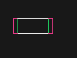

# Tools_C 4.2.1 verification

2026-11-13. [Implementation](../docs/release-v4.2.1.md) uses the current canonical
skills/helpers and existing MCP; no second production implementation was added.

- Pre-change checkpoints: Tools_C `6ac0484`; Blender integration `0b61168`.
- Complete final-source regression: **497/497 PASS**, 279.026 seconds, including
  managed comparison-image delivery. Focused comparison/capture/QA regressions
  and the actual MCP image response also passed.
- L1 source checks: 52 PASS; integration: 9 PASS. Higher-level automatic SKIPs
  do not replace the explicitly executed Blender/MCP probes below.
- All 30 default canonical contexts complete; largest 59,979 / 60,000 characters.
- Blender 5.3.0 live and factory probes: world bounds, explicit shifted camera,
  rectangular image, repeated PNG hashes, silhouette deviation, camera mismatch,
  same-front/different-depth ambiguity, ring interior and source-state restoration.
- Fresh MCP client: 18 operations, central L1 checks PASS in about one second,
  unregistered root refused, Agent Vision context and silhouette PNG delivered.
  Checker stdin is isolated from the MCP transport; it is not a shell API.
- Managed comparison image: fresh MCP execute_blender_python returned one actual
  PNG ImageContent block plus structured result; this is not a pathname-only test.
- Blender bridge lifecycle/authentication regressions: 16/16 PASS.
- USER/PRIVATE Tools_C plugin 4.2.1 created; release
  `pluginrel_6af6f776a3248191a6376a0651f37f44`. Routing/App/YAML readback matches;
  service-normalized manifests preserve version, icons, prompts and bindings.
  Original icon SHA-256: `f73639b607bb3b97d3f00458c53ab5728e01adc4d5755cfe0d7a9cf885c6578e`.

The controlled width change produced IoU 0.7861 and contour p95 7 px. This is a
known fixture deviation, not an artistic similarity score or a universal threshold.
The foreground map and contour overlay identify the changed area:

Reproduce with `tests/blender_vision_probe.py` in an isolated factory Blender
process and a new external output directory. Machine-local raw evidence is in
Work_Utility/tools-c-4.2.1; the report includes only compact current evidence.

Limits: explicit reference segmentation and declared camera/pose calibration;
no automatic hidden geometry, artistic, export or Godot runtime acceptance.
Fresh @Tools_C invocation in a newly selected chat is a separate user-facing
client check. The old Blender-MCP-Co remote is unavailable; its local commit and
[adapter wiring patch](../adapters/blender-mcp-4.2.1.patch) are retained.

Deployment handoff: the running connector still needs one normal Blender MCP
Restart in ConHub to load the final image-kind delegation line. UI automation
was stopped by the user with physical Escape, so no alternative restart was
attempted. Source/isolated MCP verification passed; this live reload remains
explicitly pending. Godot was not launched and the open Blender file was not saved.

Git publication targets: origin/main and the development branch, with tag v4.2.1.
Remote commit identities are compared after the final report commit is pushed.
